<div align="center">

[](#overview)


[](https://github.com/SamvitPrakash/Blockchain-Logging-Prototype/releases)

**[Overview](#overview)** · **[Architecture](#architecture)** · **[Downloads](#downloads)** · **[Requirements](#requirements)** · **[Quick Start](#quick-start)** · **[Experiments](#experiments)** · **[Evaluation](#evaluation)** · **[Findings](#findings)** · **[Citation](#citation)**

</div>

> [!IMPORTANT]
> **Download the release archive. Don't clone this repository.**
> The prototype depends on a modified `docker_open5gs` submodule commit that is not publicly fetchable, so a `git clone --recursive` will not produce a working environment. The `research-complete.zip` release is an exact snapshot of the environment used to produce the published results. See [Downloads](#downloads).

<br/>

<a id="overview"></a>

[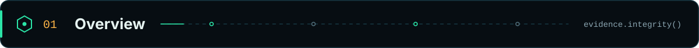](#overview)

Fifth-generation (5G) networks rely on **Network Function Virtualization (NFV)**, network slicing and edge computing. These technologies make networks flexible, but they also make **digital forensic investigations** harder. In NFV environments, logs are the main source of digital evidence, and evidence is only useful if it can be trusted. If an attacker can modify, delete or fabricate log entries, those logs can no longer be relied on in an investigation.

This repository contains the artefacts for the COS700 research report **_Feasibility Analysis of Blockchain-Based Logging for NFV Forensic Integrity in 5G Environments_**. The research proposes recording 5G network-function logs on a **permissioned Hyperledger Fabric blockchain**. Every log entry is signed by a known, CA-issued identity and committed to a tamper-evident shared ledger. The research then measures what that costs in compute, memory, network and storage.

The work contributes:

- **A blockchain-logging prototype.** BCL is deployed at every physical site and BCLm at the central data center. It fits into the ETSI NFV reference architecture as a VNF and its element manager.
- **A simulated 5G NFV testbed.** It combines an Open5GS 5G core, UERANSIM gNBs/UEs and the prototype, with Docker and Bash scripts standing in for the NFVI and NFV-MANO.
- **A parameterised experiment harness.** It deploys complete topologies of *T* towers and *L* shared ledgers from a single seed and samples per-container resource usage throughout.
- **A dataset and 36 regression models.** Together they estimate the resource overhead of any (*T*, *L*) topology, per component role and per metric.

<div align="center">

[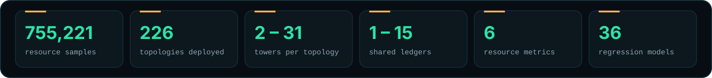](#findings)

</div>

| | |
| --- | --- |
| **Report** | Feasibility Analysis of Blockchain-Based Logging for NFV Forensic Integrity in 5G Environments |
| **Author** | Samvit Prakash |
| **Supervisor** | Mr. SM (Sheunesu) Makura |
| **Programme** | COS700 Research Report · BSc Honours Computer Science · University of Pretoria |
| **Research group** | [Digital Forensic Science Research Group (DigiFors)](https://digifors.cs.up.ac.za/students/details/121/) · Department of Computer Science |
| **Date** | October 2026 |
| **Keywords** | Blockchain · NFV · 5G · Blockchain-based logging · Edge computing · Network slicing · Digital forensics · Digital forensic readiness |

<br/>

<a id="architecture"></a>

[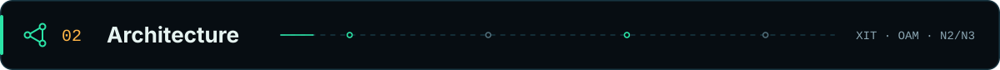](#architecture)

The prototype is a single VNF made of two parts. **BCL** (Blockchain Logging) runs once at **every physical site**, next to the gNB it serves. **BCLm** (Blockchain Logging management) runs **once at the central data center** as BCL's element manager. Every box below is a Docker container.

<div align="center">

[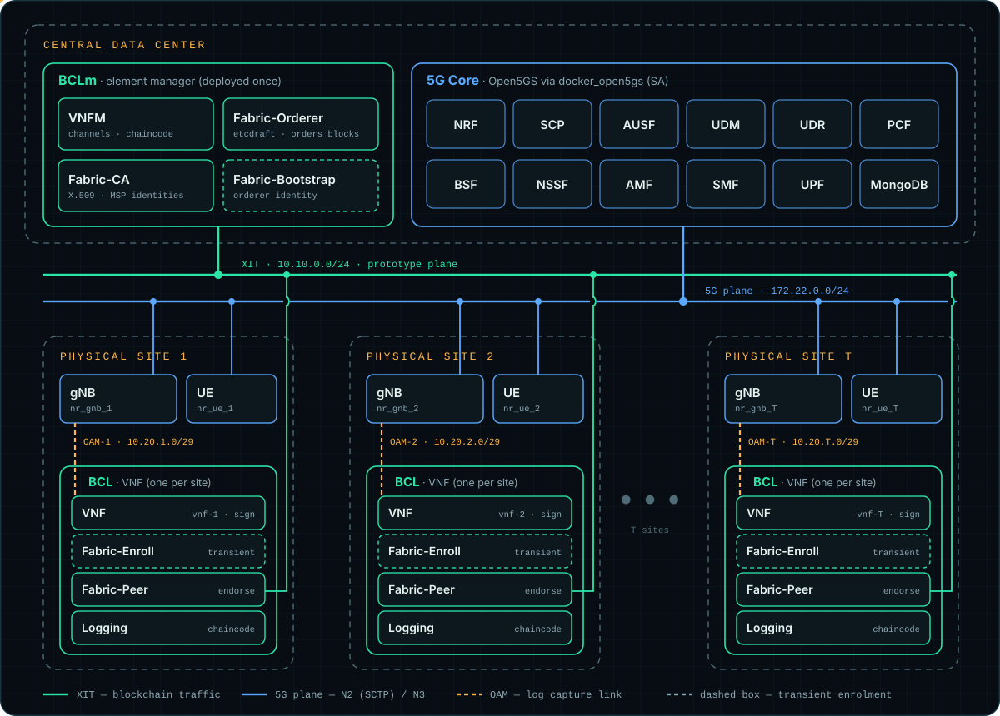](assets/architecture.svg)

</div>

| Part | Component | Container(s) | Role |
| --- | --- | --- | --- |
| **BCL** | VNF | `vnf-N` | Reads the gNB log, parses each line into a record, signs it with its own X.509 identity and submits it to the local peer |
| | Fabric-Enroll | `fabric-enroll-N` | *Transient.* Registers and enrols the peer with Fabric-CA, then exits so Compose can start the peer |
| | Fabric-Peer | `fabric-peer-N` | Unmodified Hyperledger Fabric peer. Endorses and commits transactions on the channel(s) it belongs to |
| | Logging | `dev-fabric-peer-N-logging_…` | The Node.js chaincode container, launched by the peer through the Docker builder |
| **BCLm** | VNFM | `vnfm` | Prototype-specific Fabric manager: seeded peer→channel assignment, channel joins and the chaincode lifecycle. *Not* the NFV-MANO VNFM |
| | Fabric-Bootstrap | `fabric-bootstrap` | *Transient.* Provisions the orderer's identity, then exits |
| | Fabric-CA | `fabric-ca` | Issues and manages all identities (peers, orderer, VNFs, VNFM) |
| | Fabric-Orderer | `fabric-orderer-1` | Single `etcdraft` ordering node. Orders transactions into blocks per channel |

**How a log becomes evidence**

<div align="center">

[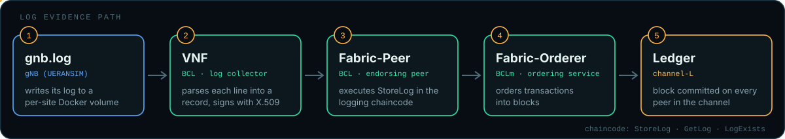](assets/log-flow.svg)

</div>

The `logging` chaincode exposes `StoreLog`, `GetLog` and `LogExists`. Each record is stored under its Fabric transaction ID, so any committed log can later be retrieved and checked against the ledger replicated across that channel's peers.

**Networks**

| Network | Subnet | Purpose |
| --- | --- | --- |
| `docker_open5gs_default` | `172.22.0.0/24` | The 5G plane: Open5GS network functions, gNBs (`172.22.0.40+`) and UEs (`172.22.0.140+`) |
| `XIT` | `10.10.0.0/24` | The prototype plane, between BCL and BCLm instances. It is modelled on the Xn interface and kept separate from the 5G core's networks |
| `OAM-N` | `10.20.N.0/29` | One per site. The only link between normal 5G operations and the prototype (gNB `.2` ↔ VNF `.3`) |

<details>
<summary><b>XIT address plan</b></summary>

| Address | Container |
| --- | --- |
| `10.10.0.1` | Gateway |
| `10.10.0.10` | `fabric-bootstrap` |
| `10.10.0.11` | `fabric-ca` |
| `10.10.0.20` | `fabric-orderer-1` |
| `10.10.0.30` | `vnfm` |
| `10.10.0.(50+N)` | `fabric-enroll-N` (transient) |
| `10.10.0.(100+N)` | `fabric-peer-N` |
| `10.10.0.(150+N)` | `vnf-N` |

</details>

<br/>

<a id="downloads"></a>

[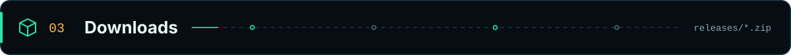](#downloads)

Everything is distributed as **[GitHub release](https://github.com/SamvitPrakash/Blockchain-Logging-Prototype/releases)** archives:

| Archive | Contains | Use it to |
| --- | --- | --- |
| **`research-complete.zip`** | The full research environment: prototype, scripts, templates, the vendored `docker_open5gs` tree, experiment harness, evaluation code and all results | Run the prototype, re-run the experiments or re-run the evaluation |
| **`experiment-results.zip`** | The contents of `experiments/results/`: `metrics.csv` (755,221 samples), `test_1/info.txt` and 226 `topology_experiment_N.json` files | Analyse the raw dataset without downloading the environment |
| **`evaluation-results.zip`** | The contents of `evaluation/results/`: `aggregated.csv`, `models.csv` (36 fitted models) and all figures (PNG + PDF) | Use the regression models and figures directly |

`research-complete.zip` already includes both result sets. The other two archives are lighter downloads if you only need the data.

```bash
# Optional: check the archive against the SHA-256 published with the release (chain of custody, after all)
sha256sum research-complete.zip

unzip research-complete.zip
cd Blockchain-Logging-Prototype
```

> [!TIP]
> Extract with the `unzip` command so the scripts keep their executable bits. If you used a graphical archive tool and get `Permission denied`, run this from the project root:
> `find . -name '*.sh' -exec chmod +x {} +`

To use only the data archives:

```bash
unzip experiment-results.zip -d experiment-results    # metrics.csv, test_1/
unzip evaluation-results.zip -d evaluation-results    # aggregated.csv, models.csv, figures
```

<br/>

<a id="requirements"></a>

[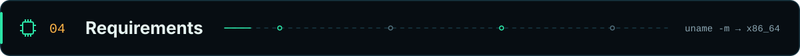](#requirements)

The prototype was developed and run on **Arch Linux**. Other systemd-based distributions should work if they meet the requirements below, but they have not been tested.

**Host platform**

| Requirement | Details |
| --- | --- |
| **OS** | Linux. macOS, Windows and WSL2 are not supported. The scripts need GNU userland and Bash 4+, and the 5G stack needs host kernel features (below) |
| **CPU architecture** | **x86_64 / amd64.** The VNF image downloads the `linux-amd64` `fabric-ca-client`, so ARM hosts (Apple Silicon, Raspberry Pi, Graviton) will not work |
| **Docker** | **Native, rootful Docker Engine** running as a system service with its socket at `/var/run/docker.sock`. Fabric peers mount this socket to build chaincode containers, and the gNB, UE and UPF containers run `--privileged`. **Docker Desktop and rootless Docker are not supported** |
| **Privileges** | `sudo`. All entry points are run with `sudo`, and `run_test.sh` calls `sudo` itself |
| **Internet** | Required on the first run, to pull base images and build Open5GS and UERANSIM from source (GitHub, apt, npm, NodeSource and the MongoDB repo) |

**Software (versions used during development)**

| Package | Version | Notes |
| --- | --- | --- |
| Docker Engine | `29.7.2` | |
| Docker Compose plugin | `5.5.0` | `docker compose …` (v2-style plugin, not legacy `docker-compose`) |
| Docker Buildx plugin | `0.36.1` | Used by `docker build` and by Compose to build `docker_metrics` |
| Python | 3.x | Used on the host by the topology generator. Standard library only |
| `envsubst` | GNU gettext | Renders the gNB/UE configs. On Arch it comes with `gettext`; on Debian/Ubuntu it's in `gettext-base` |
| Core utilities | Bash ≥ 4, coreutils, grep, sed, awk, findutils | The scripts use `declare -A`, `mapfile`, `date --iso-8601`, `realpath` and `xargs -r` |
| `unzip` | any | To extract the release archives |

> [!NOTE]
> Older versions of Docker, Compose and Buildx may work but have not been tested. `jq`, `configtxgen`, `peer` and `mongosh` all run **inside** containers, so you don't need them on the host.

**Kernel and network**

| Requirement | Why |
| --- | --- |
| **SCTP** kernel module | The gNB ↔ AMF link (N2) uses SCTP, and containers share the host kernel. Arch and Ubuntu load it on demand. Fedora and RHEL block it by default |
| **TUN** device (`/dev/net/tun`) | Used by the UPF and the UERANSIM UEs |
| **Free subnets** | `172.22.0.0/24`, `10.10.0.0/24` and `10.20.1.0/29`–`10.20.50.0/29` must not overlap your LAN, a VPN or existing Docker networks |
| **Free host ports** | `3000` (Grafana), `9090` (Prometheus metrics) and `9999` (Open5GS WebUI) |

**Hardware**

The scripts don't enforce any hardware minimum, but the published dataset gives a guide. Summed over the prototype's own containers (excluding the 5G core and image builds), peak memory was about **1.3 GB at 2 towers**, **4.8 GB at 12** and **8 GB at 27**. Peak CPU reached roughly **14 cores' worth**.

| | Recommended |
| --- | --- |
| Memory | **16 GB+** for sweeps up to ≈30 towers |
| CPU | **8+ cores** |
| Disk | **100 GB+ free.** Images, build cache and per-topology state build up quickly (the development host once filled a 100 GB disk) |
| Host | **A dedicated machine or VM.** See the [teardown warnings](#teardown) |

<details>
<summary><b>Install on Arch Linux (tested)</b></summary>

```bash
sudo pacman -S --needed docker docker-compose docker-buildx python gettext unzip
sudo systemctl enable --now docker
sudo modprobe -a sctp tun
```

</details>

<details>
<summary><b>Install on Debian / Ubuntu (untested)</b></summary>

Install Docker Engine from Docker's own repository ([docs.docker.com/engine/install](https://docs.docker.com/engine/install/)), including `docker-ce`, `docker-compose-plugin` and `docker-buildx-plugin`. Don't use the distribution's `docker.io` package or Docker Desktop. Then:

```bash
sudo apt install python3 gettext-base unzip
sudo systemctl enable --now docker
sudo modprobe -a sctp tun
```

</details>

**Pre-flight check**

```bash
uname -m                                         # x86_64
sudo docker version --format '{{.Server.Version}}'
docker compose version
docker buildx version
python3 --version
command -v envsubst
sudo modprobe -a sctp tun && ls /dev/net/tun     # both must succeed
ss -ltn | grep -E ':(3000|9090|9999)\b'          # expect no output
ip route | grep -E '172\.22\.0\.|10\.10\.0\.|10\.20\.'   # expect no output
```

<br/>

<a id="quick-start"></a>

[](#quick-start)

Run every command from the **project root** (`Blockchain-Logging-Prototype/`). The scripts use relative paths.

**1 · First run on a new machine**

```bash
rm -f scripts/.init
```

`scripts/.init` is a marker file that tells `init.sh` the one-time setup has already been done. It may be present in the archive from the development machine. Removing it makes the first run build every image and start the 5G core.

**2 · Deploy a topology**

```bash
sudo ./scripts/generate.sh <towers> <ledgers> <seed>

# e.g. 4 towers split across 2 shared ledgers
sudo ./scripts/generate.sh 4 2 23525119
```

| Argument | Meaning | Valid values |
| --- | --- | --- |
| `towers` (*T*) | Physical sites: one gNB, UE and BCL instance each | `2` – `50` |
| `ledgers` (*L*) | Fabric channels (shared ledgers) the peers are divided across | `1` – `⌊T/2⌋`. Each ledger needs at least two peers |
| `seed` | Seed for the pseudo-random peer → channel assignment. The same seed gives the same topology | Any integer |

> [!NOTE]
> `create-instance.sh` accepts up to 100 towers, but above **50** the transient `fabric-enroll-N` addresses (`10.10.0.50+N`) collide with already-running peers (`10.10.0.100+N`) on the XIT network. The published experiments used at most 31.

The **first** run takes much longer. `init.sh` builds the five prototype images (`blockchain-fabric-bootstrap`, `blockchain-fabric-ca`, `blockchain-fabric-enroll`, `blockchain-logging-vnf`, `blockchain-vnfm`), compiles Open5GS and UERANSIM from source, starts the Open5GS core (`sa-deploy.yaml`) and only then writes `scripts/.init`. Later runs skip this.

<details>
<summary><b>What <code>generate.sh</code> does, stage by stage</b></summary>

| # | Stage | Script |
| --- | --- | --- |
| 1 | One-time initialisation: build images, start the 5G core | `scripts/init.sh` |
| 2 | Tear down the previous topology and clear `build/` | `scripts/teardown.sh`, `scripts/clean.sh` |
| 3 | Create the XIT network | `scripts/networks/XIT/setup-XIT.sh` |
| 4 | Create *T* gNB/UE pairs, register the subscribers in MongoDB, create and attach `OAM-N` | `scripts/gnb-ue/create-and-start.sh` |
| 5 | Generate and start Fabric-CA and Fabric-Bootstrap → Fabric-Orderer | `scripts/fabric-ca/create.sh`, `scripts/fabric-bootstrap/create.sh` |
| 6 | Generate and start *T* Fabric-Enroll → Fabric-Peer pairs | `scripts/fabric-enroll/create-instance.sh` |
| 7 | Generate the seeded topology (`build/fabric-network/topology.json`), `configtx.yaml` and channel blocks, then join the peers | `scripts/fabric-network/create.sh`, `join-peers.sh` |
| 8 | Start the VNFM (orderer joins, chaincode lifecycle) and *T* VNFs | `scripts/vnfm/create.sh`, `scripts/vnf/create.sh` |

Generated compose files and state live in `build/`, which is cleared on every run.

</details>

**3 · Watch it work**

```bash
sudo docker ps --format 'table {{.Names}}\t{{.Status}}'
sudo docker logs -f vnf-1                       # "Submitting …" → "Committed log for gnb-1"
cat build/fabric-network/topology.json          # which peer joined which channel
```

A deployment is ready when the **last** tower's VNF logs the gNB message `PDU session resource(s) setup for UE[1] count[1]`. That is the completion signal the experiment harness waits for. The Open5GS WebUI is at `http://localhost:9999` and Grafana is at `http://localhost:3000` (`open5gs` / `open5gs`).

<a id="teardown"></a>

**4 · Tear down**

| Command | Removes | Keeps |
| --- | --- | --- |
| `sudo ./scripts/teardown.sh` | All towers (gNB/UE), every BCL and BCLm container, chaincode containers, `OAM-N` and `XIT` networks, gNB log volumes, and the registered subscribers | The 5G core, built images and `build/` files (`generate.sh` clears these itself) |
| `sudo ./scripts/teardown-verbose.sh` | **Everything on the Docker host**: every container, volume, non-default network and image, plus the BuildKit cache, `build/` and `scripts/.init` | Nothing |

> [!CAUTION]
> **`teardown-verbose.sh` is not scoped to this project.** It stops and deletes *every* container, volume, network and image on the machine, including ones that have nothing to do with the prototype. This is deliberate: a single sweep can create hundreds of uniquely named containers, volumes and networks, and tracking them all reliably wasn't practical. Use it only on a dedicated host or VM. After running it, the next `generate.sh` repeats the full first-run initialisation.

<br/>

<a id="experiments"></a>

[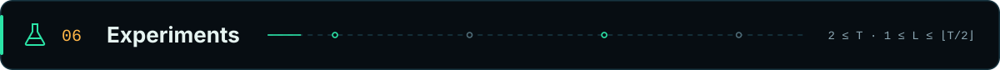](#experiments)

The experiment measures how the number of towers *T* and shared ledgers *L* affect the CPU, memory, network and disk usage of each prototype component. Each valid configuration is deployed **from scratch**: teardown → generate → wait for the network → settle. Meanwhile, a separate logger records `docker stats` for every prototype container at a nominal one-second interval.

```math
\mathcal{C}=\Big\{(T,L)\;\Big|\;T_{\text{start}}\le T\le T_{\text{end}},\;1\le L\le\Big\lfloor\tfrac{T}{2}\Big\rfloor\Big\}
```

**Before you start**

> [!CAUTION]
> `experiments/run.sh` **ends by running `teardown-verbose.sh`**, which wipes every Docker container, volume, network and image on the host. Run the experiments only on a dedicated machine or VM.

1. **Create the logger's state file.** The resource logger (`test_1.sh`) is started before the first experiment writes `experiments/current_experiment`. That file isn't included in the archive, so without it the logger exits straight away and nothing is recorded:

   ```bash
   printf 'experiment=1\ntowers=2\nshared_ledgers=1\n' > experiments/current_experiment
   ```

2. **Keep the published dataset safe (recommended).** New samples are **appended** to `experiments/results/metrics.csv`, and `topology_experiment_N.json` files are overwritten. To start a clean dataset, move the published one aside first:

   ```bash
   mv experiments/results experiments/results-published
   ```

**Run**

```bash
sudo ./experiments/run.sh <start_towers> <end_towers> <seed>
```

| Argument | Meaning |
| --- | --- |
| `start_towers` | First tower count *T* to deploy (≥ 2) |
| `end_towers` | Last tower count *T* to deploy (≤ 50, see the note in [Quick Start](#quick-start)) |
| `seed` | Generation seed passed to every deployment |

For each *T*, the harness deploys every *L* from 1 to ⌊*T*/2⌋. That makes Σ⌊*T*/2⌋ full deployments, each followed by a 60-second settling period, so even modest ranges take many hours.

**Reproducing the published dataset**

```bash
sudo ./experiments/run.sh 2 31 23525119
```

The published sweep used seed **23525119**. Its `info.txt` records an end value of 100, but the sweep reached **31 towers** (226 topologies: every configuration up to *T* = 30, plus *T* = 31, *L* = 1), the limit of what the development host's resources could support. The command above covers the same range, which adds the remaining *T* = 31 configurations (240 deployments in total).

**Outputs** (in `experiments/results/`)

| File | Contents |
| --- | --- |
| `metrics.csv` | One row per container per sample: `timestamp, experiment, towers, shared_ledgers, container, cpu_percent, memory_bytes, network_rx_bytes, network_tx_bytes, block_read_bytes, block_write_bytes` |
| `test_1/info.txt` | Start/end tower count and seed of the sweep |
| `test_1/topology_experiment_N.json` | The exact peer → channel assignment used by experiment *N* |

<br/>

<a id="evaluation"></a>

[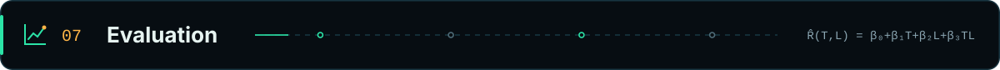](#evaluation)

The evaluation turns the raw samples into per-role averages and fits an ordinary least squares model for each of the **6 component roles** (VNF, Fabric-Peer, Logging, VNFM, Fabric-CA, Fabric-Orderer) and **6 metrics** (CPU, memory, network rx/tx, block read/write). That gives **36 models** of the form:

```math
\hat{R}_{c,m}(T,L)=\beta_{0}+\beta_{T}\,T+\beta_{L}\,L+\beta_{TL}\,T L
```

Deployment-wide estimates multiply each role by its number of instances: *T* for VNF, Peer and Logging, and 1 for VNFM, CA and Orderer.

```math
\hat{R}_{\text{total},m}(T,L)=\sum_{c} n_c(T,L)\,\hat{R}_{c,m}(T,L)
```

**Run** (Python 3.10+, `numpy`, `matplotlib`):

```bash
cd evaluation
python3 -m venv .venv && source .venv/bin/activate
pip install numpy matplotlib

python prepare.py   --csv ../experiments/results/metrics.csv --out results
for n in 01 02 03 04 05 06; do python figure_$n.py --aggregated results/aggregated.csv --out results; done
python model.py     --aggregated results/aggregated.csv --out results

# Estimate any topology from the fitted models
python predict_topology.py --models results/models.csv --towers 50 --channels 10
```

| Output | Contents |
| --- | --- |
| `results/aggregated.csv` | Per-experiment, per-role averages derived from `metrics.csv` |
| `results/models.csv` | The 36 fitted models: coefficients, held-out RMSE (every fifth experiment held out) and the observed *T*/*L* range |
| `results/{cpu,memory,network_rx,network_tx,disk_read,disk_write}.{png,pdf}` | Resource-usage figures by component role |

`evaluation/README.md` covers the method's caveats in detail (asynchronous sampling, counter differencing and the lack of phase labels).

<br/>

<a id="findings"></a>

[](#findings)

> **Within the conditions evaluated, blockchain-based logging is computationally feasible in a 5G NFV environment. Its overhead isn't a fixed cost: it depends on the deployment's topology.** For that reason, the report provides predictive models that let an operator size a deployment against its own infrastructure, rather than a single feasibility threshold.

- **Site-level roles dominate the total.** Per instance, the Fabric-Peer (≈40–60 MiB), Logging chaincode and VNF stay roughly flat as *T* grows, but they are replicated at every site. In the *T* = 50, *L* = 10 example they account for ≈94% of the CPU and ≈98% of the memory.
- **Centralised roles grow per instance.** The Fabric-Orderer grows in memory (+1.07 MiB per tower), network traffic and block writes (+0.019 MiB/s per ledger). The VNFM has the steepest CPU slope (+0.276 percentage points per tower), and the Fabric-CA grows in CPU and block writes.
- **Network and disk activity stay small.** Reception stays below ≈0.03 MiB/s for every role. Transmission is dominated by the orderer (≈0.1 MiB/s at the top of the range), and block reads are negligible.
- **Adding ledgers at a fixed *T*** lowers the estimated CPU of the logging chaincode (−0.281 percentage points per ledger) and the memory of the peer and VNFM. Interaction terms partly offset this.

<table>
<tr>
<td width="50%">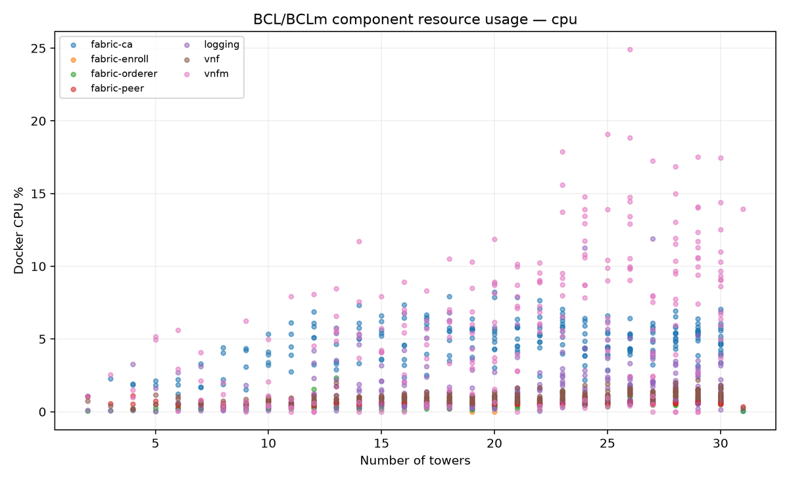</td>
<td width="50%">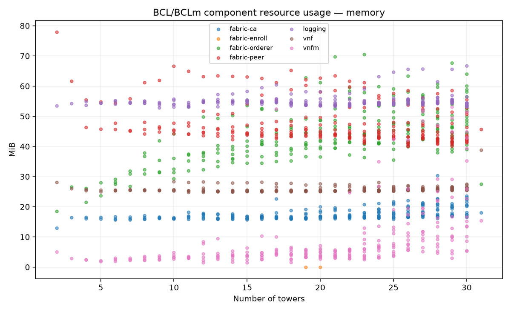</td>
</tr>
<tr>
<td align="center"><sub>CPU utilisation (Docker CPU %) by role</sub></td>
<td align="center"><sub>Memory consumption by role</sub></td>
</tr>
</table>

<details>
<summary><b>Worked example: T = 50 towers, L = 10 ledgers (extrapolated)</b></summary>

This topology lies beyond the 31 towers that were measured, so it is an **extrapolation** and is not experimentally validated.

| Role | Instances | CPU (pp) / instance | Memory (MiB) / instance |
| --- | ---: | ---: | ---: |
| VNF | 50 | 2.1 | 28.0 |
| Fabric-Peer | 50 | 0.8 | 56.9 |
| Logging | 50 | 4.7 | 57.0 |
| VNFM | 1 | 16.9 | 58.6 |
| Fabric-CA | 1 | 6.3 | 24.3 |
| Fabric-Orderer | 1 | 1.4 | 65.7 |
| **Total** | | **≈ 405 pp** | **≈ 7,243 MiB (≈ 7.1 GiB)** |

CPU is in Docker CPU percentage points, which add across cores (100 pp ≈ one core).

</details>

<br/>

<a id="repository-layout"></a>

[](#repository-layout)

```text
Blockchain-Logging-Prototype/
├── scripts/                    # Orchestration (stands in for the NFVI / NFV-MANO)
│   ├── generate.sh             #   deploy a topology:  <towers> <ledgers> <seed>
│   ├── init.sh                 #   one-time image builds + 5G core start (writes scripts/.init)
│   ├── teardown.sh             #   remove the prototype and towers
│   ├── teardown-verbose.sh     #   remove EVERYTHING on the Docker host
│   ├── clean.sh                #   clear build/
│   ├── open5gs/                #   build Open5GS / UERANSIM images, start the core
│   ├── networks/{XIT,OAM}/     #   prototype and per-site OAM networks
│   ├── gnb-ue/                 #   per-site gNB + UE generation and start-up
│   ├── fabric-ca/  fabric-bootstrap/  fabric-enroll/
│   ├── fabric-network/         #   seeded topology, configtx, channel blocks, peer joins
│   ├── vnfm/                   #   BCLm VNFM
│   └── vnf/                    #   BCL VNF
├── templates/                  # Dockerfiles, entrypoints and configs for every prototype image
│   ├── vnf/src/main.js         #   log collector + Fabric Gateway client
│   └── vnfm/chaincode/         #   the `logging` chaincode (StoreLog / GetLog / LogExists)
├── experiments/
│   ├── run.sh                  # sweep:  <start_towers> <end_towers> <seed>
│   ├── test_1/                 # run_test.sh (one deployment) · test_1.sh (resource logger)
│   └── results/                # metrics.csv · test_1/info.txt · topology_experiment_N.json
├── evaluation/                 # prepare.py · figure_0N.py · model.py · predict_topology.py
│   └── results/                # aggregated.csv · models.csv · figures
├── docker_open5gs/             # Vendored docker_open5gs (Open5GS core + UERANSIM), with prototype changes
├── build/                      # Generated per deployment (cleared on every run)
├── Notes/                      # Development notes
└── fabric-samples/             # Vendored for reference; not used by the scripts
```

<br/>

<a id="limitations"></a>

[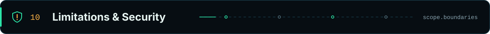](#limitations)

**Research scope**

- **Lifecycle, not sustained load.** Each topology was measured over deployment, the commit of a known transaction for every tower, and a 60-second settle. Throughput, latency and continuous logging workloads were not evaluated.
- **One run per topology, one seed, one host.** Interpolated predictions inside the measured region (T 2–31, L 1–15) are estimates. Extrapolations beyond it are not validated.
- **Abstracted NFVI / NFV-MANO.** Docker, Compose and Bash stand in for the management layers, and the OSS/BSS is not implemented.
- **Direct log capture.** The VNF reads the gNB's log file through a shared volume. A production system would need a log-provisioning mechanism.
- **No archival or rotation.** Ledgers grow without bound. A real deployment would archive logs off-chain and keep only the verification data on the ledger.

> [!WARNING]
> **This is a research testbed, not a hardened deployment.** Fabric peers have access to the host's Docker socket, which is equivalent to root on the host. Several containers run `--privileged`. The CA bootstrap credentials and subscriber keys are fixed test values. Run it on an isolated machine and don't expose its ports to untrusted networks.

<br/>

<a id="troubleshooting"></a>

[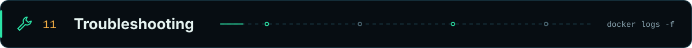](#troubleshooting)

<details>
<summary><b><code>Error: MongoDB container 'mongo' is not running.</code></b></summary>

The one-time initialisation was skipped, so the 5G core never started. Run `rm -f scripts/.init` and run `generate.sh` again.

</details>

<details>
<summary><b><code>Subscriber … already exists in MongoDB</code> / <code>instance N already exists</code></b></summary>

A previous deployment wasn't fully removed. Run `sudo ./scripts/teardown.sh`, then deploy again.

</details>

<details>
<summary><b><code>existing XIT network has subnet …</code> / <code>Pool overlaps with other one on this address space</code></b></summary>

Another Docker network or a host route already uses one of the prototype's subnets. Remove the conflicting network or disconnect the VPN, then try again.

</details>

<details>
<summary><b>The experiment logger prints <code>Experiment state file does not exist</code></b></summary>

Create `experiments/current_experiment` as described in [Before you start](#experiments), then start the sweep again.

</details>

<details>
<summary><b>gNBs never connect to the AMF</b></summary>

Check that SCTP is available on the host (`sudo modprobe sctp`), and check the gNB log with `sudo docker exec nr_gnb_1 cat /mnt/gnb-logs/gnb.log`.

</details>

<details>
<summary><b>The disk fills up</b></summary>

Check usage with `sudo docker system df`. A full reset is `sudo ./scripts/teardown-verbose.sh`. Read the [caution](#teardown) first.

</details>

<br/>

<a id="citation"></a>

[](#citation)

If you use the prototype, dataset or models, please cite the research report:

```bibtex
@techreport{prakash2026blockchainlogging,
  author      = {Prakash, Samvit},
  title       = {Feasibility Analysis of Blockchain-Based Logging for NFV Forensic Integrity in 5G Environments},
  institution = {Department of Computer Science, University of Pretoria},
  type        = {COS700 Research Report},
  year        = {2026},
  month       = oct,
  note        = {Supervised by S. M. Makura. Artefacts: https://github.com/SamvitPrakash/Blockchain-Logging-Prototype}
}
```

<br/>

<a id="acknowledgements"></a>

[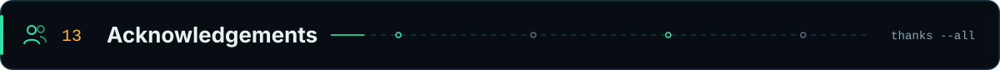](#acknowledgements)

- **Mr. SM (Sheunesu) Makura**, for supervising this research, and the **[Digital Forensic Science Research Group](https://digifors.cs.up.ac.za/)** at the University of Pretoria.
- This work builds on Makura & Venter, *Towards the Development of a Digital Forensic Readiness Model for 5G NFV Environments* (IST-Africa 2024).
- Third-party components keep their own licences:
  - [Hyperledger Fabric](https://github.com/hyperledger/fabric) and [Fabric CA](https://github.com/hyperledger/fabric-ca) (Apache-2.0)
  - [Open5GS](https://github.com/open5gs/open5gs) (AGPL-3.0)
  - [UERANSIM](https://github.com/aligungr/UERANSIM) (GPL-3.0)
  - [docker_open5gs](https://github.com/herlesupreeth/docker_open5gs) by Supreeth Herle (BSD-2-Clause, licence included in `docker_open5gs/LICENSE`)

<br/>

<div align="center">

[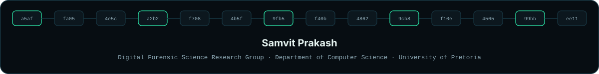](https://github.com/SamvitPrakash)

[](https://github.com/SamvitPrakash)
[](mailto:u23525119@tuks.co.za)
[](https://digifors.cs.up.ac.za/students/details/121/)

</div>
